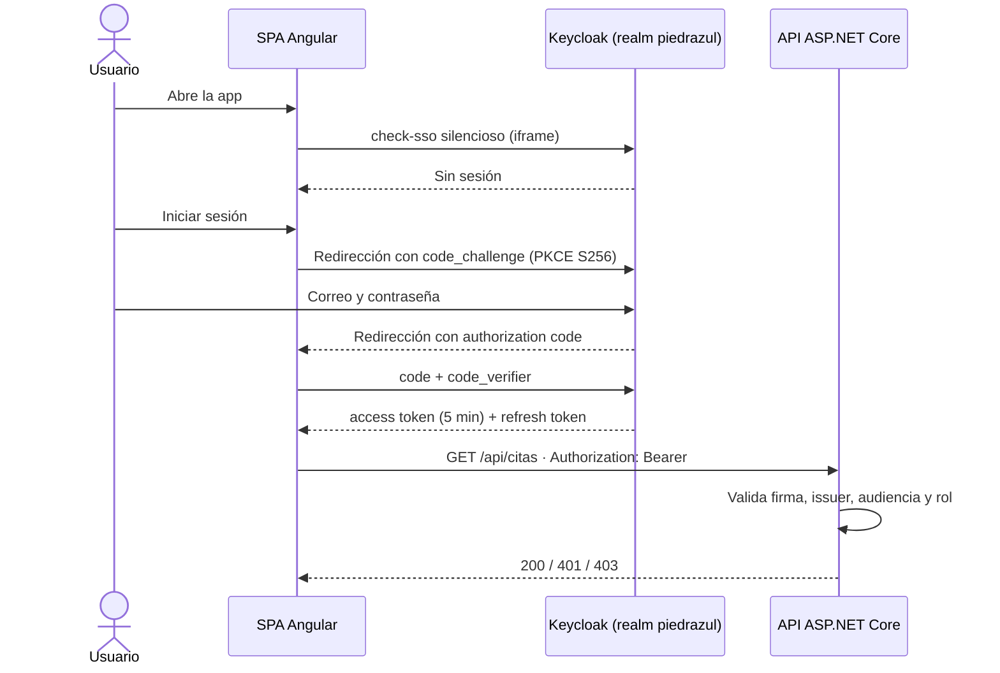
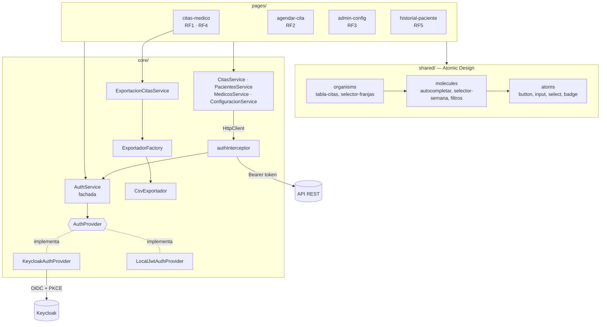

# Frontend — Citas Médicas Piedrazul

SPA en Angular 21 para el sistema de reserva de citas de Piedrazul. Este documento describe el estado del **segundo corte**.

## Contenido

1. [Cómo ejecutarlo](#1-cómo-ejecutarlo)
2. [Requisitos implementados](#2-requisitos-implementados)
3. [Autenticación y autorización con Keycloak](#3-autenticación-y-autorización-con-keycloak)
4. [Arquitectura del frontend](#4-arquitectura-del-frontend)
5. [Patrones de diseño GoF](#5-patrones-de-diseño-gof)
6. [Escenarios de calidad de seguridad](#6-escenarios-de-calidad-de-seguridad)
7. [Pruebas](#7-pruebas)
8. [Contrato con el backend](#8-contrato-con-el-backend)

---

## 1. Cómo ejecutarlo

Requisitos: Node.js LTS, npm y Docker (para Keycloak y MongoDB).

```bash
# Desde la raíz del repositorio: MongoDB, Mongo Express y Keycloak (importa el realm piedrazul)
docker compose up -d

# Frontend
cd frontend
npm install
npm start            # http://localhost:4200
```

La primera vez Keycloak tarda alrededor de un minuto en arrancar e importar el realm. Está listo cuando http://localhost:8080/realms/piedrazul responde.

### Trabajar sin el backend real

Mientras el backend termina la migración, se puede usar una API simulada que implementa los contratos del segundo corte:

```bash
npm run mock-api     # http://localhost:5039, en otra terminal
```

La API simulada lee los roles del token de Keycloak pero **no valida la firma**: es solo para desarrollo.

### Usuarios de prueba

| Rol | Correo | Contraseña | Pantalla de inicio |
|---|---|---|---|
| Paciente | paciente@example.com | Paciente123 | `/agendar` |
| Agendador | agendador@example.com | Agendador123 | `/citas` |
| Médico | medico@example.com | Medico123 | `/citas` (solo su agenda) |
| Terapista | terapista@example.com | Terapista123 | `/citas` (solo su agenda) |
| Administrador | admin@example.com | Admin123 | `/admin/configuracion` |

### Configuración

Todo está en `src/environments/environment.ts`:

```ts
apiUrl: 'http://localhost:5039/api',
auth: {
  proveedor: 'keycloak',   // 'local' vuelve al login propio del primer corte
  keycloak: { url: 'http://localhost:8080', realm: 'piedrazul', clientId: 'piedrazul-frontend' }
}
```

---

## 2. Requisitos implementados

| Requisito | Pantalla | Qué hace |
|---|---|---|
| RF1 · Listar citas de un profesional por fecha | `/citas` | Filtro por profesional y fecha, tabla ordenada por hora, total de citas, filtros por estado (con conteo) y por nombre o cédula del paciente. |
| RF2 · Agendar cita por la web | `/agendar` | Flujo en cuatro pasos: profesional, día, horario y confirmación. Una tira semanal muestra cuántos cupos libres tiene cada día antes de elegirlo. Si otro paciente toma la franja (409), se refresca la disponibilidad. |
| RF3 · Configurar parámetros | `/admin/configuracion` | Días de atención, franja horaria, intervalo y semanas habilitadas por profesional, con validación antes de enviar. |
| RF4 · Exportar citas a CSV | `/citas` | Exporta las citas visibles a CSV (formato para Excel con `;` y tildes correctas, o CSV estándar). Incluye una columna «Asistió» vacía para usarla en la jornada. |
| RF5 · Historial por cédula | `/historial` | Autocompletado de pacientes por cédula, ficha con totales y próxima cita, e historial de la más reciente a la más antigua con filtro por estado. |
| RNF1 · JWT con Keycloak | todas | OIDC Authorization Code + PKCE, menú y rutas según el rol del token. |

Mejoras sobre el primer corte:

- La fecha de hoy se calcula en hora local. Antes se usaba `toISOString()`, que en Colombia devolvía el día siguiente después de las 7 p. m.
- Las horas se muestran sin segundos (`08:30` en lugar de `08:30:00`).
- La tabla hace scroll interno en móvil en lugar de ensanchar la página.
- Mientras se verifica la sesión al cargar, se muestra «Cargando Citas Médicas…» en vez de una pantalla en blanco.
- Accesibilidad: foco visible, enlace «Saltar al contenido», autocompletado navegable con teclado (patrón combobox de WAI-ARIA) y movimiento reducido respetado.

---

## 3. Autenticación y autorización con Keycloak



Decisiones:

- **El token vive en memoria**, no en `localStorage`. Un script inyectado (XSS) no puede leerlo del almacenamiento del navegador.
- **Renovación transparente**: antes de cada petición se renueva el token si le quedan menos de 30 segundos.
- **El interceptor solo envía el token a la API** (`environment.apiUrl`), nunca a otros dominios.
- **Los guards son ayuda de navegación, no seguridad.** La autorización real la hace la API con `[Authorize(Roles = ...)]`. Un usuario autenticado sin el rol va a `/no-autorizado` (no al login, para evitar ciclos).
- **Un médico o terapista solo ve su agenda**: si el token trae el claim `medico_id`, el selector de profesional queda fijo. La API debe aplicar la misma regla.

| Rol | Rutas |
|---|---|
| Paciente | `/agendar`, `/mis-citas` |
| Agendador | `/citas`, `/historial` |
| Médico, Terapista | `/citas` (su agenda), `/historial` |
| Administrador | `/citas`, `/historial`, `/admin/configuracion` |

La gestión de usuarios y roles se hace en la consola de Keycloak (http://localhost:8080, `admin` / `admin`) o con Postman contra la Admin REST API, como permite el enunciado.

---

## 4. Arquitectura del frontend

El frontend sigue **Atomic Design** en la capa de presentación y separa la lógica de acceso a datos, sesión y exportación en `core/`.

```text
src/app/
├── core/
│   ├── auth/        # Keycloak, login local, fachada de sesión, guards e interceptor
│   ├── export/      # Estrategias de exportación (CSV) y su fábrica
│   ├── models/      # Interfaces que reflejan los DTO de la API
│   ├── services/    # Clientes HTTP por recurso (citas, médicos, pacientes, configuración)
│   └── utils/       # Fechas, filtros de citas y traducción de errores HTTP
├── pages/           # Una página por caso de uso (RF1–RF5, login, registro, sin permiso)
└── shared/
    ├── atoms/       # button, input-field, select-field, badge-estado
    ├── molecules/   # filtro-fecha-medico, filtro-estados, autocompletar-paciente, selector-semana, form-field
    ├── organisms/   # tabla-citas, selector-franjas, formularios de login, registro y configuración
    ├── pipes/       # hora
    └── templates/   # layout-principal
```



Principios SOLID aplicados:

- **Responsabilidad única**: las moléculas son presentacionales (el autocompletado emite el texto y la página decide cómo consultar). Las utilidades de fechas y filtros son funciones puras y probadas por separado.
- **Abierto/cerrado**: agregar un formato de exportación o un proveedor de identidad no exige tocar las pantallas.
- **Inversión de dependencias**: `AuthService` depende de la interfaz `AuthProvider` (token `AUTH_PROVIDER`), no de keycloak-js. Por eso el login local del primer corte sigue disponible cambiando una línea.

---

## 5. Patrones de diseño GoF

| Patrón | Dónde | Problema que resuelve |
|---|---|---|
| **Strategy** | `core/export/exportador-citas.ts`, `csv-exportador.ts` | RF4 pide un formato «compatible con hojas de cálculo». Excel en Colombia espera `;` y otros programas `,`. Cada formato es una estrategia intercambiable; la pantalla no sabe cuál usa. |
| **Strategy** | `core/auth/auth-provider.ts` | El backend migra de JWT propio a Keycloak en este corte. `KeycloakAuthProvider` y `LocalJwtAuthProvider` cumplen el mismo contrato y se eligen por configuración, sin cambiar componentes. |
| **Adapter** | `core/auth/keycloak-auth.provider.ts` | keycloak-js tiene su propia API (`init`, `updateToken`, `tokenParsed`). El adaptador la traduce al contrato `AuthProvider` y convierte el token en una `SesionUsuario`. |
| **Factory Method** | `core/export/exportador.factory.ts`, `core/auth/auth.config.ts` | Centraliza la creación: la fábrica entrega el exportador por id y `crearAuthProvider()` decide qué proveedor inyectar según el entorno. |
| **Facade** | `core/auth/auth.service.ts` | Componentes, guards e interceptor necesitan sesión, roles, token y ruta de inicio. La fachada ofrece una sola API simple y oculta al proveedor concreto. |
| **Chain of Responsibility** | `core/auth/auth.interceptor.ts` | Cada petición HTTP pasa por la cadena de interceptores de Angular. Este eslabón agrega el token solo si la petición va a la API y maneja el 401; luego pasa al siguiente. |
| **Observer** | Signals y RxJS en `historial-paciente.ts` y `layout-principal.ts` | El menú reacciona solo cuando cambia la sesión. El autocompletado observa lo que se escribe (`debounceTime` + `switchMap`) y cancela búsquedas viejas. |

---

## 6. Escenarios de calidad de seguridad

### Escenario 1 · Acceso a una función sin el rol adecuado (autorización)

| Elemento | Descripción |
|---|---|
| Fuente | Un paciente autenticado |
| Estímulo | Intenta abrir `/historial` escribiendo la URL o llama `GET /api/citas/historial` con su token |
| Artefacto | Rutas de la SPA y endpoints de la API |
| Entorno | Operación normal, sesión válida |
| Respuesta | La SPA lo envía a `/no-autorizado` sin mostrar datos; la API responde 403 aunque se salte la SPA |
| Medida | 100 % de las rutas restringidas tienen guard de rol y 100 % de los endpoints restringidos tienen `[Authorize(Roles)]`; ningún dato de otro paciente llega al navegador |
| Resultado esperado | Solo Agendador, Administrador, Médico y Terapista consultan historiales |

### Escenario 2 · Token vencido o robado (autenticación)

| Elemento | Descripción |
|---|---|
| Fuente | Un atacante con un token copiado, o un usuario cuya sesión venció |
| Estímulo | Usa el token después de su expiración |
| Artefacto | Keycloak, interceptor HTTP y validación JWT de la API |
| Entorno | Operación normal |
| Respuesta | La API rechaza con 401; la SPA descarta la sesión y lleva al login |
| Medida | El access token dura 5 minutos; la sesión de Keycloak expira tras 30 minutos de inactividad; el token no se guarda en `localStorage` |
| Resultado esperado | Un token filtrado deja de servir en minutos, no en horas |

### Escenario 3 · Fuerza bruta contra el login (autenticación)

| Elemento | Descripción |
|---|---|
| Fuente | Un atacante externo |
| Estímulo | Prueba contraseñas repetidamente contra una cuenta |
| Artefacto | Pantalla de login de Keycloak |
| Entorno | Operación normal |
| Respuesta | Keycloak bloquea la cuenta temporalmente |
| Medida | Bloqueo tras 5 intentos fallidos, con espera creciente de hasta 15 minutos; contraseñas de al menos 8 caracteres con un dígito |
| Resultado esperado | Adivinar una contraseña por fuerza bruta deja de ser práctico |

### Aportes al informe OWASP ZAP

- El servidor de desarrollo envía `X-Content-Type-Options`, `X-Frame-Options: SAMEORIGIN`, `Referrer-Policy` y `Permissions-Policy` (ver `angular.json`). La falta de estas cabeceras es una de las alertas típicas de ZAP sobre una SPA.
- El CSV escapa celdas que empiezan por `=`, `+`, `-` o `@` para evitar inyección de fórmulas (*CSV injection*).
- El campo de cédula descarta caracteres que no pueden ir en un documento.
- Pendiente para producción: `Content-Security-Policy` en el servidor que sirva la SPA (en desarrollo rompería la recarga en caliente de Angular).

---

## 7. Pruebas

```bash
npm test             # Vitest, 71 pruebas
```

| Archivo | Qué prueba |
|---|---|
| `core/auth/auth.service.spec.ts` | Restaurar y cerrar sesión, roles, ruta de inicio |
| `core/auth/keycloak-auth.provider.spec.ts` | PKCE S256, sesión desde el token, renovación y fallos de Keycloak |
| `core/auth/local-jwt-auth.provider.spec.ts` | Login del primer corte y tokens expirados |
| `core/auth/auth.interceptor.spec.ts` | Bearer solo hacia la API, manejo de 401 y 403 |
| `core/auth/auth.guards.spec.ts` | Redirecciones por sesión y por rol |
| `core/auth/jwt.utils.spec.ts`, `roles.spec.ts` | Lectura de tokens de Keycloak y de ASP.NET, filtro de roles |
| `core/export/*.spec.ts` | CSV (escape RFC 4180, BOM, inyección de fórmulas), fábrica y descarga |
| `core/utils/*.spec.ts` | Fechas locales, filtros y orden de citas, mensajes de error |
| `shared/molecules/autocompletar-paciente/*.spec.ts` | Mínimo de caracteres, navegación con teclado, consulta directa |
| `shared/organisms/*/*.spec.ts` | Validación de configuración (RF3) y de registro |

Además, el flujo completo se verificó en un navegador con Keycloak 26.0.7 real y la API simulada, con los cinco roles: login, agenda, filtros, exportación, autocompletado, historial, agendamiento, mis citas, cierre de sesión, redirección por rol y vista móvil.

---

## 8. Contrato con el backend

Los endpoints nuevos, los cambios de roles y la validación del token de Keycloak en ASP.NET Core están en [`docs/contratos-api-segundo-corte.md`](../docs/contratos-api-segundo-corte.md).
